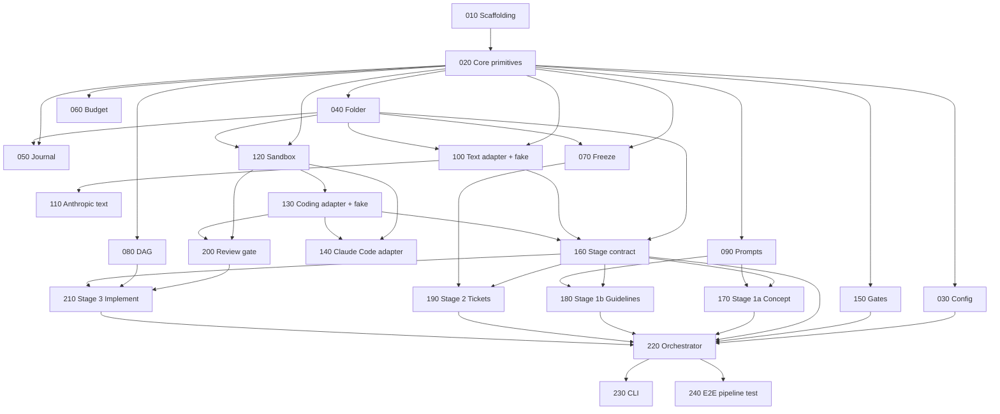

# T-000 — Overview / index ticket (Harness v0)

**Phase:** v0 — Walking skeleton
**Status:** index ticket (no code; defines the build for every other ticket)

This is the index for the v0 implementation tickets. It defines the dependency
graph, the build order, the ticket schema, and the conventions every ticket must
follow. It is written against the **concept** (`ai-harness-concept.md`, the
architectural source of truth) and the **v0 guidelines**
(`harness-v0-guidelines.md`, the engineering source of truth). Where they
conflict, the concept wins and the resolution is logged in `DECISIONS.md`.

---

## 1. v0 scope (what these tickets cover)

Per concept §19, v0 is the *walking skeleton*:

- CLI orchestrator; the project folder is the state.
- **Single provider:** Anthropic for all text stages, Claude Code (`claude -p`)
  for implementation. No per-stage *provider* pluggability yet (that is v1).
- Interactive gates (approve / edit / reject), with `auto_approve` / `stop`
  policies.
- File confinement **plus** container code-execution.
- `run.log` + budget guard.

Explicitly **out of scope for v0** (do not implement; reject if a ticket drifts
into it): provider pluggability beyond Anthropic + Claude Code, OpenCode, prompt
A/B tooling (v1); parallel DAG execution, web UI, multi-phase management (v2).
The adapter *seams* are still built in v0 (so v1 is config + a small adapter, not
a rewrite), but only the single-provider implementations ship.

---

## 2. Dependency graph

Edges point **prerequisite → dependent** (i.e. an arrow means "must be built
first"). Only the primary `depends-on` edges are drawn; `relates-to` links are
listed inside each ticket.

---

## 3. Build order (a valid topological ordering)

1. **T-010** Project scaffolding & tooling
2. **T-020** Core primitives (Clock, IdGen, exceptions)
3. **T-030** Config model & loader
4. **T-040** Project-folder access (state)
5. **T-050** Journal (run.log + DECISIONS/PROGRESS + JSON mirrors)
6. **T-060** Budget guard
7. **T-070** Spec freeze + hashing
8. **T-080** Ticket DAG (parse, cycles, topo sort)
9. **T-090** Prompt templates + renderer
10. **T-100** TextStageAdapter protocol + contract suite + FakeTextAdapter
11. **T-110** Anthropic text adapter
12. **T-120** Sandbox (file confinement + container execution)
13. **T-130** CodingAgentAdapter protocol + contract suite + FakeCodingAgent
14. **T-140** Claude Code (`claude -p`) adapter
15. **T-150** Interactive gates
16. **T-160** Stage contract (base Protocol)
17. **T-170** Stage 1a — Concept
18. **T-180** Stage 1b — Guidelines
19. **T-190** Stage 2 — Tickets
20. **T-200** Per-ticket review gate
21. **T-210** Stage 3 — Implementation driver
22. **T-220** Orchestrator (state machine)
23. **T-230** CLI
24. **T-240** End-to-end pipeline test (fakes)

Independent branches may be parallelised by humans (the adapter branch, the DAG
util, prompts and gates can all proceed once T-020/T-040 land), but v0 itself runs
**synchronously** — async/parallel execution is deferred (guidelines §1).

---

## 4. Ticket schema (every ticket follows this)

- **Goal** — the single problem the ticket solves.
- **Creates / changes** — the exact module(s)/files, matching the src layout in
  guidelines §2.
- **Acceptance criteria** — objective, testable conditions for "done".
- **Out of scope** — what the ticket explicitly does not do.
- **Connections** — `depends on` / `blocks` / `relates to`, by ticket ID.
- **Testing** — which discipline applies (see §6) and the key cases.
- *(Optional further sections where useful, e.g. Notes.)*

**One problem, one ticket** (concept §9.3): each ticket is independently
implementable and reviewable, sized to be completed from the concept, the
guidelines, this overview, and the ticket itself — one ticket touches roughly one
module (guidelines §2).

---

## 5. Conventions (binding on all tickets)

**Tech stack & tooling** (guidelines §1): Python 3.12+; **uv** for env/lockfile;
**ruff** for lint *and* format; **pyright** or `mypy --strict` (strict mode
mandatory); **pytest** (+ `pytest-cov`); **pydantic v2** for config/journal
schemas; **typer** for the CLI; stdlib `subprocess` for agent/Docker; stdlib
`logging` → JSON lines for `run.log`.

**Coding standards** (guidelines §3): typed throughout (no unjustified ignores);
stages are pure functions over the folder (read only declared inputs, write only
declared outputs); all side effects (network, subprocess, container) live behind
the adapter protocols and `sandbox.py`; the frozen spec is immutable; determinism
is injected (Clock / IdGen), never assumed; explicit over implicit (no
module-level mutable globals, typed exceptions, never silently swallowed); small,
single-purpose modules.

**File locations:** exactly the `src/harness/...` layout in guidelines §2.
Ticket files live at `spec/tickets/0NN-<slug>.md`; IDs are `T-0NN`.

---

## 6. Testing policy (guidelines §4)

- **Test-first** for deterministic pure logic: `dag`, `config`, `journal`,
  `freeze`, `budget`, `prompts`, the orchestration logic, the stage logic.
- **Test-after / contract tests** for thin glue over external systems: provider
  adapters, the `claude -p` wrapper, `sandbox` container execution. A shared
  contract suite is the bar each adapter implementation must pass against a
  double; real adapters are smoke-tested separately.
- **Fakes** (`FakeTextAdapter`, `FakeCodingAgent`) drive full-pipeline tests with
  no real models, containers, or spend.
- **Meaningful tests only**: assert observable behaviour/outputs, must fail on
  regression, no vacuous passes. Required edge cases include empty DAG, cyclic
  DAG, missing inputs, budget exceeded mid-run, crash-and-resume, gate rejection,
  retry-budget exhaustion. Coverage is measured (`pytest-cov`) but **not gated**
  on a line percentage — the bar is behavioural.

---

## 7. Definition of done (per ticket)

Mirrors the gate the harness imposes on its own targets (guidelines §5):

1. Acceptance criteria met; nothing implemented that the ticket marked out of
   scope.
2. Tests meaningful and **green**.
3. **ruff** (lint + format) and the **strict type checker** clean.
4. Journals updated — one `PROGRESS.md`/`progress.json` entry (ticket ID,
   summary, deviations); any conflict/ambiguity recorded in
   `DECISIONS.md`/`decisions.json` (concept outranks guidelines).
5. One ticket → one small change set → one PR, referencing the ticket ID, with a
   conventional commit message (e.g. `feat(dag): topological sort [T-080]`).

We dogfood: the journals are maintained even though humans build v0, so the
resume path and journal format are exercised for real.

---

## 8. Post-review tickets (added 2026-07-04)

A code review of the completed v0 tickets against the concept and guidelines
produced two follow-up batches. They follow the same schema and conventions as
§4–§7; each ticket carries its own Connections.

**v0.1 — hardening (correctness flaws found in review):**

- **T-300** Phase boundary must stop *after* implementing the active phase.
- **T-310** Actually record model/agent calls to `run.log`; surface budget warnings.
- **T-320** Persist gate outcomes; rejected artifacts must not pass on re-run.
- **T-330** Upstream changes invalidate downstream (re-freeze, working `--from`).
- **T-340** Parse the real `claude -p --output-format json` envelope.
- **T-350** Brainstorm loop: feed answers back to the model; fix the round cap.
- **T-360** Typed error for unknown DAG refs + ticket-id normalisation.
- **T-370** Budget: pre-call headroom check; config-time rate validation.
- **T-380** Sandbox: confine the implementer agent; add timeouts.
- **T-390** Journal true-append + atomic mirrors; freeze version collisions.
- **T-400** Wire the dead config knobs (`prompts.*`, review flags).
- **T-410** Final acceptance pass: templated, read-only, surfaced to the user.
- **T-420** Anthropic adapter: truncation detection, configurable max_tokens, retries.

Suggested order: T-390 → T-310 → T-320 → T-330 → T-300 → T-360 → T-370 →
T-420 → T-340 → T-380 → T-400 → T-350 → T-410 (journal/log plumbing first,
then state-machine correctness, then adapter/sandbox realism, then stage
fidelity).

**v0.2 — improvements (boosting the harness's core goals):**

- **T-500** Structured model-output contracts (stop regex-scraping prose).
- **T-510** Unified cost accounting: Stage 3 spend under the budget cap.
- **T-520** Ticket-declared test scope + real changed-path detection.
- **T-530** Escalation UX: stuck runs hand back a resumable, actionable state.
- **T-540** Deferred-phase ticket archiving + `harness phase` activation.
- **T-550** Optimised prompt templates (replace the eight placeholders).
- **T-560** Observability surface: spend and run history in `harness status`.

Suggested order: T-500 → T-550 → T-510 → T-520 → T-530 → T-540 → T-560
(contracts first — several others build on them). T-510/T-540 additionally
require v0.1 tickets (see their Connections).
