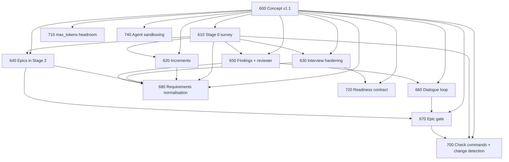

# T-000 — Overview / index ticket (Harness v1: increments, epics, review dialogue)

**Phase:** v1 — increments, epics, review dialogue (+ four approved improvements)
**Status:** index ticket (no code; defines the build for every other ticket in `tickets-v1/`)

This is the index for the v1 ticket batch. It extends the completed v0 build
(`tickets-v0/`: T-010…T-240 plus the post-review batches T-300…T-560, all implemented as
of 2026-07-05) with six requirements raised on 2026-09-14 and four improvements approved
the same day. It is written against the **concept** (`ai-harness-concept.md`, the
architectural source of truth — amended to v1.1 by T-600 before any code ticket starts)
and the **v0 guidelines** (`harness-v0-guidelines.md`, the engineering source of truth).
Where they conflict, the concept wins and the resolution is logged in
`harness/journal/DECISIONS.md`.

---

## 1. v1 scope — the requirements this batch implements

| # | Requirement (2026-09-14) | Assessment against v0 | Tickets |
|---|--------------------------|-----------------------|---------|
| R1 | Input = requirements (or a draft concept with requirements) + a project folder that may be empty or already contain a project | Partly: requirements yes; existing code is invisible to every spec stage (declared-IO); no entry path for a draft concept | T-610, T-630 |
| R2 | Requirements are immediate — everything in `requirements.md` is built now; still flexible for later versions; closes concept §20's cross-phase archiving item | Different model: concept §6.3 let the author defer scope into phases (T-300/T-540); a changed `requirements.md` on a finished project was silently ignored | T-620 (+ T-600) |
| R3 | Interview routine addressing open questions, ambiguities and improvements; max iterations configurable with a default | Already handled (`brainstorm.max_rounds`, T-170/T-350); the residual gaps are improvements | T-630 |
| R4 | Epics of AI-suited, minimal-context tickets; created only when sensible | Not handled: flat ticket DAG, single free-text ticket call | T-640 |
| R5 | Per-ticket implementer ↔ reviewer dialogue via the orchestrator: resolution report, findings with ids, fix-or-argue, configurable max iterations, escalation with proposals | Partly: fresh-process reviewer, retry budget and escalation exist (T-200/T-210/T-530); no report, no ids, no argument path, no proposals | T-650, T-660 |
| R6 | End-to-end test per epic, written beforehand (TDD) | Not handled: per-ticket scoped tests + one full-suite pass + LLM-only final pass | T-670 |

Approved improvements to the existing harness: **T-700** (guideline-declared check
commands + root-wide change detection), **T-710** (real `max_tokens` in the headroom
check), **T-720** (readiness self-check contract), **T-740** (agent sandboxing). T-730 is
intentionally unused — the reviewer-cost gap it was reserved for is closed by T-650.

**Added 2026-09-18** on the user's question whether a prompt-optimisation step right
after submission makes sense: **T-680** Stage 0a requirements normalisation — a gated,
traceable restructuring of `requirements.md` (ids, kinds, priorities, verbatim source
quotes, flagged ambiguities, a coverage report) that every downstream prompt consumes,
while the original file stays the untouched authority. It enhances R1, R3 and R6
rather than adding a requirement of its own.

**Design decisions confirmed by the user on 2026-09-14** (binding; T-600 writes them
into the concept):

- **Increment model.** One run = one immediate requirements document applied to the
  current folder; a Stage 0 survey feeds the spec stages; a changed requirements hash
  starts a new increment (the old spec is archived under `spec/.history/`); phasing
  stays available but dormant behind `implementation.phasing: single`.
- **Epic = testable slice + epic DAG with the closure rule**, always at least one epic.
- **Fresh implementer and reviewer processes every round**; the round artifacts on
  disk are the memory (concept principle 1, "the project folder is the state").

Explicitly **out of scope for v1** (reject if a ticket drifts into it): epic-level
parallel execution or any async fan-out (v2 — the seams exist); a web UI; provider
pluggability beyond Anthropic + Claude Code, and the OpenCode adapter (the roadmap's
original "v1 — pluggability" moves to v1.x; T-600 records this); git-based diffing;
resuming agent sessions across rounds; enforcing per-domain network allowlists inside
the container.

---

## 2. Key definitions (binding on all tickets)

- **Increment** — one immediate requirements document applied to the current project
  folder; identified by `inc-NNNN` plus `sha256(requirements.md)` in
  `spec/increment.json`. A run belongs to exactly one increment; a later version is a
  new increment over the (now non-empty) folder.
- **Greenfield folder** — a project root containing nothing but harness-owned files
  (`requirements.md`, `instructions.md`, `harness.config.yaml`, `spec/`, `journal/`).
  Anything else is an existing project.
- **Epic** — a vertically cohesive slice of the concept that delivers one externally
  observable capability (a feature, a bounded context, or a foundation such as
  scaffolding/tooling) and is verifiable on its own by an end-to-end acceptance test
  that can only pass once all of its tickets are done. Sized 3–10 tickets; every
  ticket belongs to exactly one epic; every increment has at least one epic.
- **Epic DAG and the closure rule** — epics may depend on epics (acyclic). A ticket may
  depend on a ticket of another epic **only if its epic declares a dependency on that
  epic**. Build order = epics in topological order, then tickets in topological order
  within each epic.
- **Round** — one implementer (IA) turn producing code plus a `ResolutionReport`,
  followed by the objective checks and — only if they are green — one reviewer (RA)
  turn producing `ReviewFindings`. Both turns are fresh `claude -p` processes.
  `implementation.max_review_rounds` (default 3) bounds the rounds per unit before
  escalation.
- **Finding** — one reviewer observation with a stable id (`F-NNN`; synthetic
  `F-OBJ-N` from failed objective checks, `F-RPT-N` from a missing or invalid
  report), a severity (`blocker` > `major` > `minor` > `nit`), a location, a required
  action and a status (`open`, `resolved`, `declined_accepted`, `declined_rejected`).
  Only findings in `implementation.blocking_severities` (default blocker + major)
  block a `pass`; every finding must nevertheless be fixed or explicitly declined.
- **Unit** — what Stage 3 journals in `progress.json` and resumes on: ticket ids
  `T-0NN`, `E0N::acceptance-test`, `E0N::close`, `__final_acceptance__`.
- **Requirement id** — `R-NNN`, assigned by Stage 0a (T-680) to one verifiable
  statement of the user's requirements, with a verbatim source quote. Epics list the
  ids they deliver and the final acceptance pass judges per id. The original
  `requirements.md` remains the authority; the normalised form is derived and gated.

---

## 3. Dependency graph

Edges point **prerequisite → dependent**. Only in-batch `depends-on` edges are drawn;
each ticket's Connections also list the v0 tickets it builds on and its `relates-to`
links.

---

## 4. Build order (a valid topological ordering)

1. **T-600** Concept amendment v1.1 — gated by the user before any code ticket
2. **T-610** Stage 0 project survey
3. **T-620** Increment model + dormant phasing
4. **T-650** Review findings contracts + reviewer adapter
5. **T-660** Review dialogue loop, resolution reports, escalation proposals
6. **T-640** Epics in Stage 2
7. **T-670** Epic gate + acceptance tests
8. **T-630** Interview hardening
9. **T-680** Requirements normalisation (Stage 0a; added 2026-09-18)
10. **T-720** Readiness self-check contract
11. **T-700** Declared check commands + root-wide change detection
12. **T-710** Real `max_tokens` in the headroom check
13. **T-740** Agent sandboxing

T-710 and T-740 depend only on T-600 within the batch and may be pulled forward. T-700
is optional for Python targets but required before running the harness on an existing
non-Python project. v1 itself still runs **synchronously** (guidelines §1).

---

## 5. Ticket schema (every ticket follows this)

Unchanged from `tickets-v0/000-overview.md` §4: **Goal**, **Creates / changes**,
**Acceptance criteria**, **Out of scope**, **Connections** (`depends on` / `blocks` /
`relates to`, by ticket id), **Testing**, plus optional sections (v1 tickets open with
a **Motivation** or **Problem** section, as the v0.1/v0.2 batches did). One problem,
one ticket; each ticket is implementable from the concept (v1.1), the guidelines, this
overview and the ticket itself.

---

## 6. Conventions (binding on all tickets)

All of `tickets-v0/000-overview.md` §5 (stack, coding standards, file locations), plus:

- **Contracts first.** Any model output a parser consumes is a pydantic model in
  `contracts.py`, parsed with `parse_structured` and at most one bounded re-ask
  (T-500). Outputs of a `claude -p` agent process get **no** re-ask process: a bad
  output becomes a synthetic finding for the next round.
- **Every prompt is a versioned template** under `prompt_templates/v1/`, listed in
  `prompts.NAMED_TEMPLATES`, and covered by `test_prompt_template_consistency.py`
  (placeholders exactly match the variables the stage supplies). Retired templates are
  removed from `NAMED_TEMPLATES` and deleted.
- **Journals are append-only md + JSON mirror pairs** written through `journal.py`
  (`folder.append_text`, `folder.write_json_atomic`). New record fields are optional
  with `None`/empty defaults so every existing journal still loads. Dynamic per-ticket
  and per-epic paths use the T-190 pattern (manual `is_relative_to` confinement) where
  the static `DeclaredIOGuard` cannot list them.
- **Never delete.** Superseded artifacts move to `spec/.history/<increment>/` or
  `spec/.invalidated/<version>/` via `Orchestrator._move_aside`.
- **Config stays backward compatible.** New knobs have defaults that keep every
  existing `harness.config.yaml` valid; a deprecated alias warns through
  `on_warning` and never silently changes meaning; setting alias and replacement
  together is a `ConfigError`.
- **Fresh processes.** No adapter command ever contains `--resume` or `--continue`
  (asserted by contract tests).
- **Ids.** Ticket ids stay global 3-digit (`normalise_ticket_id` unchanged); epic ids
  `E0N`; finding ids `F-NNN` (synthetic `F-OBJ-N`, `F-RPT-N`); requirement ids
  `R-NNN` and ambiguity ids `AMB-N` (T-680); unit ids as in §2.
- **Cite the concept.** Each ticket names the v1.1 concept section it implements; the
  citations must exist after T-600.

---

## 7. Testing policy (guidelines §4)

Unchanged from `tickets-v0/000-overview.md` §6, plus: every loop (interview rounds,
review rounds, epic units) is proven with scripted fakes — call counts, prompt
contents and persisted files are asserted, never inferred; no test spawns `claude` or
Docker unless gated on their availability; template variable sets are asserted by the
consistency test for every new or changed template.

---

## 8. Definition of done (per ticket)

`tickets-v0/000-overview.md` §7 (acceptance criteria met, nothing out of scope, tests
meaningful and green, ruff + pyright clean, journals updated, one ticket → one commit
referencing the id), plus: the concept sections the ticket cites exist in v1.1, and
any new config knob is documented in the amended concept §4.
